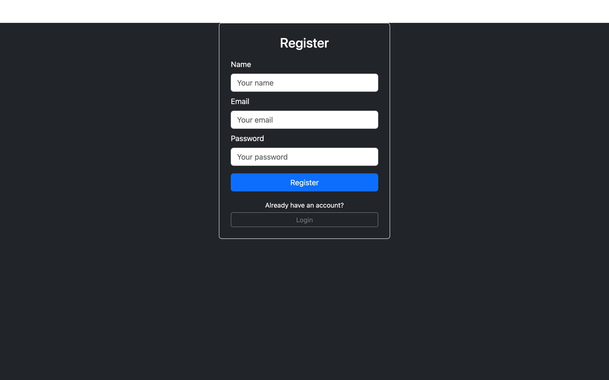

<div align="center">

# 🔑 MERN Login & Registration

User sign-up and login with a React frontend and an Express and MongoDB backend.

<a href="https://github.com/miladmo68/Login-Registration"></a>
<a href="https://miladweb.com"></a>

</div>

<p align="center">
  
</p>

## ✨ Features

- Sign up and log in
- Express API with Mongoose models
- React Router and Bootstrap UI

## 🛠️ Tech Stack

       

> [!NOTE]
> This project needs its own backend, database or API keys, so it runs locally rather than as a static demo.

## 🚀 Getting Started

**Prerequisites:** [Node.js](https://nodejs.org/) 18 or newer · A MongoDB database (local or MongoDB Atlas)

**Clone**

```bash
git clone https://github.com/miladmo68/Login-Registration.git
cd Login-Registration
```

**client**

```bash
cd client
npm install
npm run dev
```

**server**

```bash
cd server
npm install
npm start
```

## 📁 Project Structure

```
Login-Registration/
├── client/
└── server/
```

## 👤 Author

**Milad Mohammadi** — Frontend-Focused Full-Stack Developer, Toronto 🇨🇦

[](https://miladweb.com)
[](https://www.linkedin.com/in/miladmo68/)
[](https://github.com/miladmo68)

<p align="center"><sub>If you like this project, consider giving it a ⭐</sub></p>
